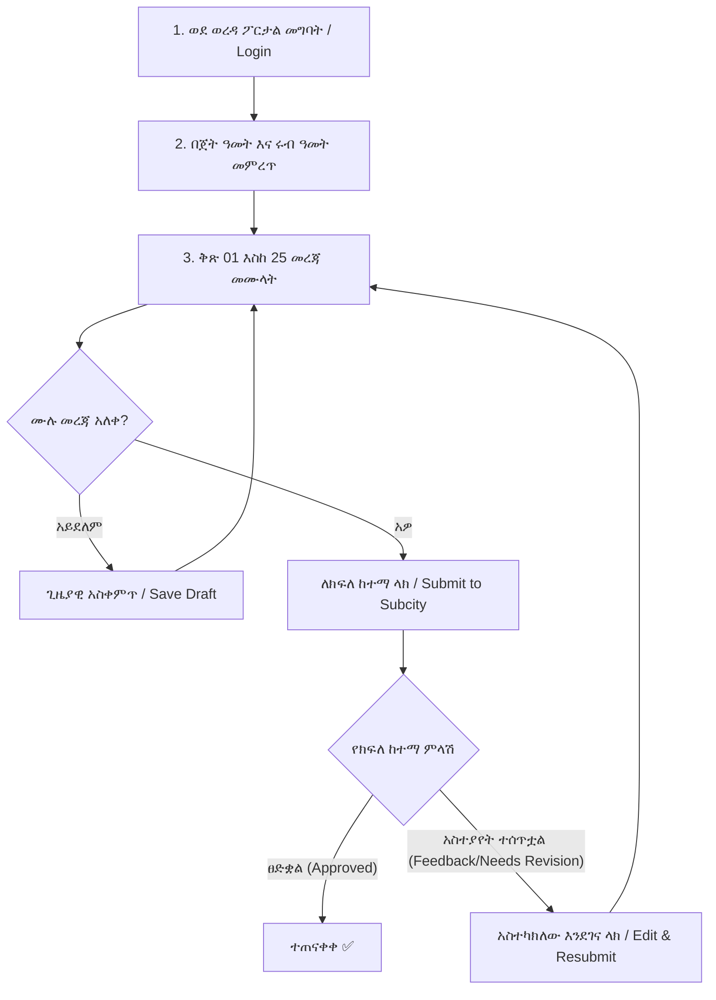
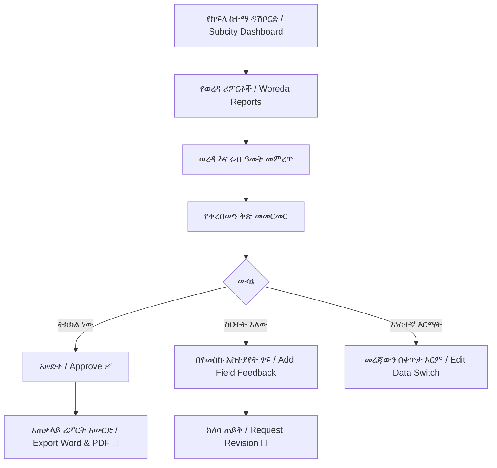

# የአቃቂ ቃሊቲ ክፍለ ከተማ እና የወረዳዎች ኢንስፔክሽን ዲጂታል ሲስተም
## የተሟላ የተጠቃሚ መመሪያ (Comprehensive User Manual)

---

## 📑 የይዘት ማውጫ (Table of Contents)

1. [ክፍል 1፡ አጠቃላይ የሲስተሙ መግቢያ እና የድረ-ገጽ አድራሻዎች](#ክፍል-1-አጠቃላይ-የሲስተሙ-መግቢያ-እና-የድረ-ገጽ-አድራሻዎች)
2. [ክፍል 2፡ የወረዳ ተጠቃሚዎች መመሪያ (Woreda User Manual)](#ክፍል-2-የወረዳ-ተጠቃሚዎች-መመሪያ-woreda-user-manual)
   - 2.1 ወደ ሲስተሙ መግባት (Login)
   - 2.2 የሪፖርት ዘመንና ወቅት መምረጥ (Period Selection)
   - 2.3 የኢንስፔክሽን ቅጾችን መሙላት (Filling Forms 01–25)
   - 2.4 ረቂቅ ማስቀመጥ (Save Draft)
   - 2.5 ሪፖርቱን ለክፍለ ከተማ መላክ (Submit Report)
   - 2.6 የክፍለ ከተማ አስተያየትን አይቶ ማስተካከል (Review Feedback & Resubmit)
3. [ክፍል 3፡ የክፍለ ከተማ አስተዳዳሪዎች መመሪያ (Subcity Admin Manual)](#ክፍል-3-የክፍለ-ከተማ-አስተዳዳሪዎች-መመሪያ-subcity-admin-manual)
   - 3.1 ወደ ክፍለ ከተማ ዳሽቦርድ መግባት
   - 3.2 የወረዳ ሪፖርቶችን በየወቅቱ መከታተልና መገምገም
   - 3.3 በየመስኩ (Field-level) እና አጠቃላይ አስተያየት መስጠት (Feedback)
   - 3.4 መረጃዎችን በቀጥታ ማረም (Direct Data Editing)
   - 3.5 ሪፖርቶችን ማጽደቅ ወይም ክለሳ መጠየቅ (Approve / Request Revision)
   - 3.6 አጠቃላይ የተጠቃለለ ሪፖርት (Aggregated Data) እና ወደ Word/PDF ማውጣት
   - 3.7 አዳዲስ ቅጾችን መፍጠርና ማስተዳደር (Form Management)
4. [ክፍል 4፡ የህዝብ አቤቱታዎችና ጥቆማዎች አያያዝ (Complaints & Suggestions Module)](#ክፍል-4-የህዝብ-አቤቱታዎችና-ጥቆማዎች-አያያዝ)
5. [ክፍል 5፡ ተደጋግመው የሚነሱ ጥያቄዎች እና መፍትሔዎች (FAQ & Troubleshooting)](#ክፍል-5-ተደጋግመው-የሚነሱ-ጥያቄዎች-እና-መፍትሔዎች)

---

## ክፍል 1፡ አጠቃላይ የሲስተሙ መግቢያ እና የድረ-ገጽ አድራሻዎች

ይህ ዲጂታል ሲስተም በአቃቂ ቃሊቲ ክፍለ ከተማ እና በስሩ በሚገኙ **12 ወረዳዎች** መካከል ያለውን የኢንስፔክሽን ስራ፣ የሪፖርት ልውውጥ፣ የውሂብ ጥንቅር (Data Aggregation) እና የህዝብ አቤቱታ/ጥቆማ አያያዝ ወደ ዘመናዊ የቴክኖሎጂ አሰራር የቀየረ ነው።

### 🌐 የሲስተሙ ዋና ዋና ድረ-ገጾች (Portals)፡
- **የክፍለ ከተማ ዋና ፖርታል እና ዳሽቦርድ:**  
  👉 [https://akakikality.raey.work](https://akakikality.raey.work)
- **የወረዳዎች ፖርታል (ለእያንዳንዱ ወረዳ የተለየ Subdomain):**
  - ወረዳ 1: `https://woreda1.akkinspection.com.et`
  - ወረዳ 2: `https://woreda2.akkinspection.com.et`
  - ወረዳ 3: `https://woreda3.akkinspection.com.et`
  - ወረዳ 4: `https://woreda4.akkinspection.com.et`
  - ወረዳ 5: `https://woreda5.akkinspection.com.et`
  - ወረዳ 6: `https://woreda6.akkinspection.com.et`
  - ወረዳ 7: `https://woreda7.akkinspection.com.et`
  - ወረዳ 8: `https://woreda8.akkinspection.com.et`
  - ወረዳ 9: `https://woreda9.akkinspection.com.et`
  - ወረዳ 10: `https://woreda10.akkinspection.com.et`
  - ወረዳ 11: `https://woreda11.akkinspection.com.et`
  - ወረዳ 13: `https://woreda13.akkinspection.com.et`

---

## ክፍል 2፡ የወረዳ ተጠቃሚዎች መመሪያ (Woreda User Manual)

የወረዳ ባለሙያዎች እና ኃላፊዎች በየሩብ ዓመቱ (Quarter) ወይም በየወቅቱ የኢንስፔክሽን ሪፖርቶችን ለማስገባት የሚከተሉትን ደረጃዎች ይከተላሉ።

### 2.1 ወደ ሲስተሙ መግባት (Login)
1. የወረዳዎን ድረ-ገጽ ይክፈቱ (ለምሳሌ፡ `https://woreda1.akkinspection.com.et`)።
2. ከላይ በቀኝ በኩል የሚገኘውን **"መግቢያ / Login"** የሚለውን ማስፈንጠሪያ ይጫኑ (ወይም በቀጥታ ወደ `/auth/login` ይሂዱ)።
3. ለወረዳዎ የተሰጠውን **ኢሜይል (Email)** እና **የይለፍ ቃል (Password)** ያስገቡ።
4. **"ግባ / Sign In"** የሚለውን ቁልፍ ይጫኑ። ወደ ወረዳዎ ዳሽቦርድ ይገባሉ።

### 2.2 የሪፖርት ዘመንና ወቅት መምረጥ (Period Selection)
1. በግራ በኩል ካለው ሜኑ **"የኢንስፔክሽን ሪፖርቶች / Inspection Reports"** የሚለውን ይምረጡ።
2. ከላይ የሚታየውን **የበጀት ዓመት (Year)** (ለምሳሌ: `2017`) ይምረጡ።
3. ሪፖርት የሚሞሉበትን **ወቅት / Period** ይምረጡ፡
   - **Q1 (1ኛ ሩብ ዓመት)**
   - **Q2 (2ኛ ሩብ ዓመት / ግማሽ ዓመት)**
   - **Q3 (3ኛ ሩብ ዓመት)**
   - **Q4 (4ኛ ሩብ ዓመት / ዓመታዊ)**
4. ወቅቱን ሲቀይሩ፣ ሲስተሙ በዚያ ወቅት ውስጥ የቀረበ ሪፖርት ካለ የነበረውን ያሳያል፤ አዲስ ከሆነ ደግሞ ባዶ ቅጽ ያዘጋጃል።

### 2.3 የኢንስፔክሽን ቅጾችን መሙላት (Filling Forms 01–25)
1. በገጹ በግራ በኩል ወይም ከላይ የቅጾች ዝርዝር (ቅጽ 01 እስከ ቅጽ 25) ይታያል።
2. ሊሞሉ ያሰቡትን ቅጽ ይምረጡ (ለምሳሌ፡ *ቅጽ 01 - የኢንስፔክሽን እቅድ አፈፃፀም*)።
3. በቅጹ ላይ የተጠየቁትን የቁጥር እና የጽሁፍ መረጃዎች በትክክል ይሙሉ፡
   - የዕቅድ አፈፃፀም መጠኖች፣
   - የተከናወኑ ተግባራት፣
   - ማብራሪያዎችና ዝርዝሮች።
4. የሰንጠረዥ ቅጽ ከሆነ **"+ አዲስ ረድፍ ጨምር (Add Row)"** የሚለውን በመጫን ተጨማሪ መረጃዎችን ማስገባት ይችላሉ።

### 2.4 ረቂቅ ማስቀመጥ (Save as Draft)
- መረጃዎችን ሞልተው ሳያጠናቅቁ ሌላ ስራ ቢገጥምዎ ወይም መረጃዎችን እያረጋገጡ ለመቆየት ከፈለጉ፡
  👉 **"ረቂቅ አስቀምጥ (Save Draft)"** የሚለውን ቁልፍ ይጫኑ።
- ሲስተሙ የሞሉትን መረጃ በሙሉ ያለምንም መጥፋት ያስቀምጥልዎታል፤ ለክፍለ ከተማው ገና አልተላከም (በማንኛውም ሰዓት ተመልሰው ማስተካከል ይችላሉ)።

### 2.5 ሪፖርቱን ለክፍለ ከተማ መላክ (Submit to Subcity)
- ሁሉንም የቅጽ መረጃዎች ትክክለኛነት ካረጋገጡ በኋላ፡
  👉 ከታች የሚገኘውን አረንጓዴ **"ለክፍለ ከተማ ላክ / Submit Report"** የሚለውን ቁልፍ ይጫኑ።
- ማረጋገጫ ሲጠይቅዎት **"አረጋግጥ / Confirm"** ይበሉ።
- የሪፖርቱ ሁኔታ ወደ **"የቀረበ / Submitted"** ይቀየራል። በዚህ ወቅት የክፍለ ከተማ አስተዳዳሪዎች ሪፖርትዎን በዳሽቦርዳቸው ማየት ይጀምራሉ።

### 2.6 የክፍለ ከተማ አስተያየትን አይቶ ማስተካከል (Review Feedback & Resubmit)
1. የክፍለ ከተማ አስተዳዳሪ ሪፖርትዎን ገምግሞ ማስተካከያ ከጠየቀዎት፣ በዳሽቦርድዎ ላይ **"ክለሳ ተጠይቋል / Needs Revision"** የሚል ቢጫ ምልክት ይታያል።
2. በቅጹ ላይ ሲገቡ፡
   - ክፍለ ከተማው የሰጠው **አጠቃላይ ማስታወሻ (General Feedback)** ከላይ ይታያል።
   - አስተያየት የተሰጠባቸው ልዩ ልዩ መስኮች (Fields) ላይ **ቀይ/ቢጫ የግብረ-መልስ ሳጥን** ይታያል።
3. የተጠየቁትን እርማቶች በቅጹ ላይ ያስተካክሉ።
4. እርማቱን ከጨረሱ በኋላ **"አስተካክለው እንደገና ላክ / Edit & Resubmit"** የሚለውን ቁልፍ ይጫኑ።

---

## ክፍል 3፡ የክፍለ ከተማ አስተዳዳሪዎች መመሪያ (Subcity Admin Manual)

የክፍለ ከተማ አስተዳዳሪዎች የወረዳዎችን ስራ ለመቆጣጠር፣ ሪፖርቶችን ለማረጋገጥ፣ ለማረምና አጠቃላይ ከተማ አቀፍ ጥንቅር ሪፖርት ለማዘጋጀት የሚከተሉትን መሳሪያዎች ይጠቀማሉ።

### 3.1 ወደ ክፍለ ከተማ ዳሽቦርድ መግባት
1. ወደ [https://akakikality.raey.work](https://akakikality.raey.work) ይሂዱ።
2. የክፍለ ከተማ አስተዳዳሪ አካውንትዎን ኢሜይልና የይለፍ ቃል ያስገቡ።
3. ወደ ዋናው የአስተዳዳሪ ዳሽቦርድ (Admin Dashboard) ይገባሉ።

### 3.2 የወረዳ ሪፖርቶችን በየወቅቱ መከታተልና መገምገም
1. በግራ በኩል ካለው ሜኑ **"የወረዳ ሪፖርቶች / Woreda Reports"** የሚለውን ይጫኑ።
2. ከላይ የሚታየውን የወረዳዎች ዝርዝር ያያሉ (ወረዳ 1 እስከ 13)። ሊመረምሩት የፈለጉትን ወረዳ ይምረጡ።
3. ከላይ ባለው የጊዜ መስመር (Period Timeline) የሚፈልጉትን ወቅት ይምረጡ (ለምሳሌ፡ **Q1, Q2, Q3, Q4** ወይም ዓመታዊ)።
4. ወረዳው ያስገባቸው ቅጾች ሁኔታ ይታያል፡
   - 🟢 **የፀደቀ (Approved)**
   - 🔵 **የቀረበ (Submitted)**
   - 🟡 **ክለሳ የሚጠብቅ (Needs Revision)**
   - ⚪ **ያልቀረበ / ረቂቅ (Draft / Not Submitted)**

### 3.3 በየመስኩ (Field-level) እና አጠቃላይ አስተያየት መስጠት (Feedback)
1. የወረዳውን ሪፖርት ከፈቱ በኋላ በእያንዳንዱ ጥያቄ ወይም የሰንጠረዥ ረድፍ ጎን **"አስተያየት አክል / Add Comment"** የሚል አዶ ያገኛሉ።
2. ስህተት ያለበትን መስክ ጠቅ በማድረግ የተወሰነ አስተያየት ይፃፉ (ለምሳሌ፡ *"የእቅድ አፈፃፀሙ ድምር ከሰንጠረዡ ጋር አይገጥምም፤ እባክዎ እንደገና ይፈትሹ"*).
3. ከገጹ ግርጌ ደግሞ **"አጠቃላይ አስተያየት (General Review Remarks)"** መፃፊያ ሳጥን ውስጥ ጠቅለል ያለ መመሪያ ይስጡ።

### 3.4 መረጃዎችን በቀጥታ ማረም (Direct Data Editing)
- ወረዳው የላከው መረጃ ላይ ግልጽ የሆነ የፊደል ወይም የቁጥር ስህተት ካለ እና ወረዳው ድረስ መልሶ ማመላለስ ካላስፈለገ፡
  1. ከላይ በቀኝ በኩል የሚገኘውን **"መረጃውን አርም / Edit Data"** የሚለውን ማብሪያ/ማጥፊያ (Toggle Switch) ያብሩ።
  2. ሳጥኖቹ ወደ መፃፊያነት ይቀየራሉ፤ ትክክለኛውን ቁጥር ያስገቡ።
  3. **"ለውጦችን አስቀምጥ / Save Changes"** የሚለውን ይጫኑ።

### 3.5 ሪፖርቶችን ማጽደቅ ወይም ክለሳ መጠየቅ
- **ክለሳ ለመጠየቅ (Request Revision):**  
  አስተያየቶችዎን ከፃፉ በኋላ **"ክለሳ ጠይቅ / Request Revision"** የሚለውን ቁልፍ ይጫኑ። ወረዳው ዳሽቦርዱ ላይ አስተያየትዎን አይቶ ማስተካከል እንዲችል ፈቃድ ይሰጠዋል።
- **ለማጽደቅ (Approve):**  
  ሪፖርቱ ሙሉ እና ትክክለኛ መሆኑን ካረጋገጡ በኋላ **"ሪፖርቱን አጽድቅ / Approve Report"** የሚለውን አረንጓዴ ቁልፍ ይጫኑ። ሪፖርቱ ቋሚ እና የፀደቀ ሆኖ ይመዘገባል።

### 3.6 አጠቃላይ የተጠቃለለ ሪፖርት (Aggregated Data) እና ወደ Word/PDF ማውጣት
1. በሪፖርቶች ገጽ ላይ **"የተጠቃለለ መረጃ / Aggregated Data"** የሚለውን ታብ ይምረጡ።
2. የሁሉንም 12 ወረዳዎች ድምር ውጤት በአንድ ሰንጠረዥ ያያሉ።
3. **"ወደ Word አውርድ (Export to Word)"** ወይም **"ወደ PDF አውርድ (Export to PDF)"** የሚለውን ቁልፍ በመጫን ለክፍለ ከተማው ካቢኔ እና አመራር የሚቀርብ ዝግጁ ይፋዊ ሰነድ ማመንጨት ይችላሉ።

### 3.7 አዳዲስ ቅጾችን መፍጠርና ማስተዳደር (Form Management)
- አዲስ የኢንስፔክሽን ጥያቄ ወይም አዲስ ቅጽ ሲያስፈልግ፡
  1. ወደ **"ቅጾች አስተዳደር / Form Management"** ገጽ ይሂዱ።
  2. **"+ አዲስ ቅጽ ፍጠር (Create New Form)"** ይጫኑ።
  3. የቅጹን ኮድ (ለምሳሌ፡ `FORM-26`)፣ ርዕስ፣ እና የመስኮች አይነት (ቁጥር፣ ጽሁፍ፣ ሠንጠረዥ) ያስገቡ።
  4. ሲያስቀምጡት **ወዲያውኑ በሁሉም 12 ወረዳዎች ፖርታል ላይ በቅጽበት ይዘምናል** (ምንም አይነት የኮድ ለውጥ ሳያስፈልግ)።

---

## ክፍል 4፡ የህዝብ አቤቱታዎችና ጥቆማዎች አያያዝ

ሲስተሙ ከዜጎች የሚመጡ አቤቱታዎችንና ጥቆማዎችን በ 5 ደረጃዎች ያስተናግዳል፡

| ደረጃ | ተግባር | ኃላፊነት ያለበት አካል | የሚላክ ማሳወቂያ |
| :--- | :--- | :--- | :--- |
| **1. ምዝገባ (Submitted)** | ዜጋው በድረ-ገጹ ቅጹን ሞልቶ ማስረጃ ሲያያይዝ ልዩ የመከታተያ ቁጥር ይሰጠዋል። | አቤቱታ አቅራቢ ዜጋ | 📱 SMS & Email ለዜጋው ይላካል |
| **2. ቅበላና ምደባ (Accepted/Assigned)** | አስተዳዳሪው የቀረበውን አቤቱታ አይቶ ይቀበላል፤ ለአጣሪ ኮሚቴ ይመድባል። | ክፍለ ከተማ አስተዳዳሪ | 📱 SMS ለዜጋው እና ለአጣሪ ኮሚቴው |
| **3. ማጣራት (Under Investigation)** | የተመደበው ኮሚቴ ሰነዶችን አጣርቶ የምርመራ ውጤት ያዘጋጃል። | አጣሪ ኮሚቴ | በሲስተም ውስጥ የጊዜ ገደብ (SLA) ይቆጠራል |
| **4. የውሳኔ ሀሳብ (Proposed Decision)** | ኮሚቴው የውሳኔ ሀሳቡን አዘጋጅቶ ለአስተዳዳሪው ያቀርባል። | የኮሚቴ ሰብሳቢ | ለኮሚሽን አመራር ማሳወቂያ ይላካል |
| **5. ማጠናቀቅ (Resolved)** | አስተዳዳሪው የመጨረሻውን ውሳኔ ያፀድቃል፤ ጉዳዩ ይዘጋል። | ክፍለ ከተማ አስተዳዳሪ | 📱 SMS & Email ዝርዝር ውሳኔው ለዜጋው ይደርሳል |

---

## ክፍል 5፡ ተደጋግመው የሚነሱ ጥያቄዎች እና መፍትሔዎች (FAQ)

### ጥያቄ 1፡ የወረዳዬን የይለፍ ቃል ከረሳሁ ምን ማድረግ አለብኝ?
> **መፍትሔ፡** በመግቢያው ገጽ ላይ **"የይለፍ ቃል ረሳሁ (Forgot Password)"** የሚለውን በመጫን በወረዳው ኢሜይል አዲስ የይለፍ ቃል ማዘጋጀት ይችላሉ፤ ወይም የክፍለ ከተማውን ሲስተም አስተዳዳሪ (Super Admin) በማነጋገር በደቂቃዎች ውስጥ አዲስ የይለፍ ቃል ማስቀየር ይቻላል።

### ጥያቄ 2፡ ለክፍለ ከተማ የተላከን ሪፖርት ወረዳው በራሱ ተነሳሽነት መልሶ ማረም ይችላል?
> **መፍትሔ፡** አንዴ ሪፖርቱ ለክፍለ ከተማ ከተላከ (Submitted ከተደረገ) በኋላ መረጃው እንዳይዛባ በወረዳው በኩል ይቆለፋል። ማስተካከል አስፈላጊ ሆኖ ሲገኝ የክፍለ ከተማው አስተዳዳሪ **"ክለሳ ጠይቅ (Request Revision)"** ሲያደርግለት ብቻ ወረዳው ዳግም ማረም ይችላል።

### ጥያቄ 3፡ ክፍለ ከተማው አዲስ ቅጽ በሲስተሙ ሲጨምር ወረዳዎች ምን ማድረግ አለባቸው?
> **መፍትሔ፡** ወረዳዎች ምንም ማድረግ አይጠበቅባቸውም! ክፍለ ከተማው አዲስ ቅጽ ባከለበት ቅጽበት በሁሉም ወረዳዎች ዳሽቦርድ ላይ ወዲያውኑ በራስ-ሰር ይታያል።

### ጥያቄ 4፡ የወረዳው ሪፖርት በየትኛው መሳሪያ (Device) ላይ ይሰራል?
> **መፍትሔ፡** ሲስተሙ ሙሉ በሙሉ በዘመናዊ የድር ቴክኖሎጂ (Responsive Web) የበለፀገ በመሆኑ በዴስክቶፕ ኮምፒውተር፣ በላፕቶፕ፣ እንዲሁም በታብሌትና በስማርት ስልክ ላይ ያለምንም እንከን ይሰራል (ይሁን እንጂ ሰንጠረዦችን ለመሙላት ላፕቶፕ ወይም ኮምፒውተር መጠቀም ይመከራል)።

---

> 🏢 **የአቃቂ ቃሊቲ ክፍለ ከተማ የብልፅግና ኢንስፔክሽንና የሥነ-ምግባር ኮሚሽን**  
> 📞 **የቴክኒክ ድጋፍ፡** ለተጨማሪ እገዛ የሲስተም አስተዳዳሪዎችን ያነጋግሩ።
